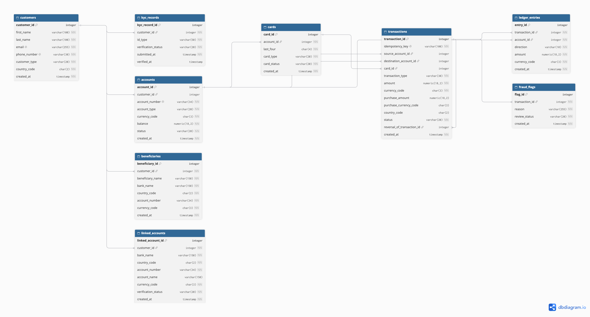

# Portfolio 1: Kaizii MFB Database Design

## 1. Case study summary

Kaizii Microfinance Bank (Kaizii MFB) is a fictional digital financial service for individuals and merchants. The design is intended to support customers in African markets. The first implementation focuses on Nigeria; foreign-exchange conversion and real card-network processing are outside this prototype. PostgreSQL stores customer details, KYC submissions, accounts, transactions, ledger postings, virtual-card references, beneficiaries, linked external accounts, and fraud alerts. All project data must be synthetic.

## 2. Entities and relationships

The model contains nine entities: `customers`, `kyc_records`, `accounts`, `beneficiaries`, `linked_accounts`, `cards`, `transactions`, `ledger_entries`, and `fraud_flags`.

One customer can have many KYC records, accounts, beneficiaries, and linked external accounts. An account can have many cards and ledger entries. A transaction can have many ledger entries and fraud flags. Transactions refer to accounts as their source or destination, can refer to a card, and can refer to an original transaction when recording a reversal. The ER diagram should be refreshed if it does not show the final columns and foreign keys.

## 3. Design decisions

Each table has a primary key. PostgreSQL identity columns generate new key values. Foreign keys protect relationships between customers, accounts, transactions, cards, and ledger entries. The default `NO ACTION` delete behavior prevents deleting a referenced parent record; reversals are recorded as new transactions so the original history remains available.

Money uses `NUMERIC`, which stores decimal values exactly. Country and currency fields use fixed-length code types. Unique constraints protect customer emails and phone numbers, account numbers, and transaction idempotency keys. Check constraints restrict values such as customer type, transaction type and status, KYC status, card suffix, ledger direction, and positive monetary amounts. Triggers require transfers to use matching account and transaction currencies, and require completed transactions to have balanced ledger entries.

Country and currency checks currently validate code format. The supported country and currency values still need to be listed and validated in the project documentation. `accounts.balance` is stored for convenient reads, so it must be updated atomically with ledger entries and checked through reconciliation.

## 4. How to run the scripts, in order

The database is named `Kaizii_MFB`. Run `00_create_database.sql` only while connected to the default `postgres` database and only if `Kaizii_MFB` does not already exist.

For a fresh setup:

1. Connect to `postgres` and run `00_create_database.sql` if the database does not already exist.
2. Connect to `Kaizii_MFB` and run `01_verify_setup.sql`.
3. Run `02_create_tables.sql` only against a new, empty database. It creates all nine tables and must not be run against the existing database.
4. Apply the saved schema-alignment and business-rule trigger migrations after table creation on a fresh setup. Those migration files still need to be added to this project before a fresh setup is reproducible. Do not rerun them on the already-migrated database.
5. Run `03_constraint_tests.sql` for row-level checks. Run `04_trigger_tests.sql` only after the trigger migration is installed. Both test scripts use synthetic records and end with `ROLLBACK`; run them against a test database.

## 5. Evidence

- `Screenshots/Okezie_Anita_301924811_postgresqldatabase.png` — initial PostgreSQL database evidence.
- `Screenshots/Okezie_Anita_301924811_databaseconnectionverification.png` — pgAdmin connection verification.
- `Screenshots/Okezie_Anita_301924811_ERD-image.png` — the nine-table ER diagram; refresh it if it differs from the final schema.
- `Screenshots/Screenshot 2026-10-20 at 8.54.28 PM.png` — pgAdmin output showing the cross-currency transfer rejection, unbalanced-ledger rejection, balanced-ledger acceptance, and rollback.

## 6. Normalisation

The design stores one value per field, separates customer, account, KYC, transaction, and ledger facts into their own tables, and avoids partial or transitive dependencies. `accounts.balance` is a deliberate denormalisation for faster balance lookups; it must remain consistent with the ledger. See [normalisation.md](normalisation.md) for the full explanation and the other repeated-value risks.

## 7. Reflection: what was difficult and what I would improve

The most difficult part was reconciling the existing database with the intended nine-table design without recreating tables or losing existing work. I learned that having nine tables does not by itself prove that the columns, constraints, and relationships meet the design rules. Cross-table rules such as matching transfer currencies and balancing ledger entries also need validation beyond a simple row-level check.

If I started again, I would inspect the database before writing the creation script, agree the supported country and currency values earlier, and save each schema change as a versioned SQL file. I would also keep the ER diagram, tests, and documentation synchronized with the database after every change.

## 8. AI use declaration

I used OpenAI Codex to help interpret the assessment guide, compare the PostgreSQL schema with the required rules, draft SQL, and organise documentation. I reviewed the SQL results in pgAdmin. The trigger checks rejected a cross-currency transfer and an unbalanced completed transaction, accepted a balanced transaction, and rolled back the synthetic test data. I remain responsible for reviewing and explaining the design and scripts submitted in this portfolio.
